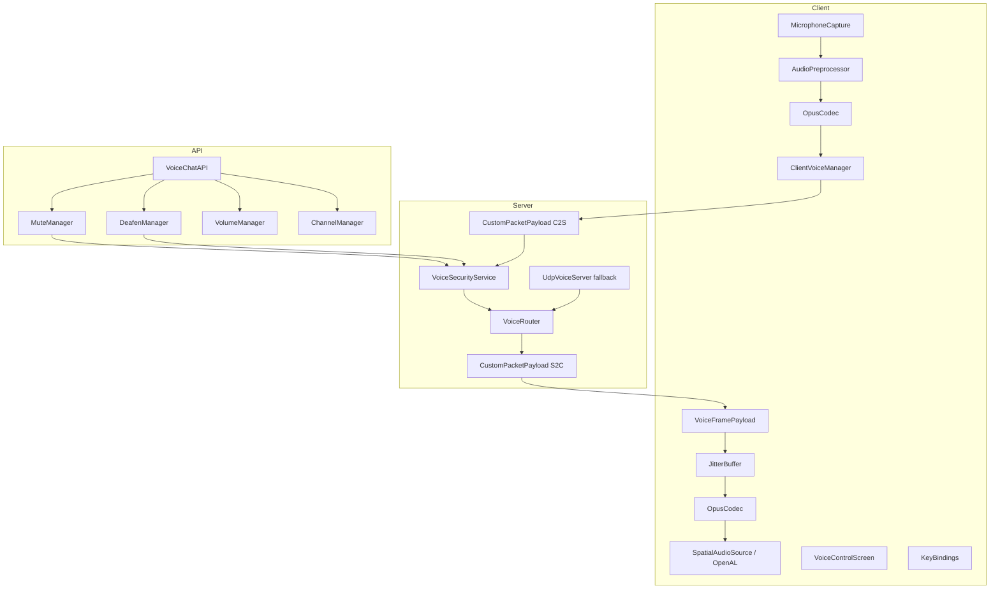

# Voicy — Proximity Voice Chat Architecture

Production architecture for a **zero-configuration**, **server-authoritative** proximity voice mod on **Minecraft Fabric 1.21 / Java 21**.

---

## 1. Module Topology

```
voicy-template-1.21/
├── voicechat-api/          # Published compile-time API (net.voicechat.api.*)
└── src/                    # Runtime mod (dev.goshi.voicy.*)
```

| Module | Role | Published artifact |
|--------|------|------------------|
| `voicechat-api` | Stable interfaces for third-party mods | `voicechat-api` JAR |
| `voicy` | Audio engine, networking, security, GUI | `voicy` mod JAR (bundles API) |

Third-party Gradle dependency:

```gradle
modImplementation "dev.goshi.voicy:voicechat-api:1.0.0"
```

---

## 2. Layered Architecture



---

## 3. Unified Connection Pipeline

### Primary: Fabric Custom Payloads

All voice frames travel as `VoiceFramePayload` over the standard play-stage Fabric channel:

| Field | Type | Purpose |
|-------|------|---------|
| `speakerId` | UUID | Must match connection owner (anti-spoof) |
| `sequence` | long | Jitter buffer ordering |
| `distanceRadius` | float | Client hint, clamped server-side |
| `opusData` | byte[] | 20–40 ms Opus frame |

Registration occurs in `VoicyNetworking.registerPayloadTypes()` via `PayloadTypeRegistry`.

### Fallback: UDP Auto-Bind

When `VoicyConfig.preferUdpFallback` is true, `UdpVoiceServer` attempts to bind to the **same port** as the Minecraft server at `SERVER_STARTED`. Handshake negotiates mode:

```java
HandshakePayload(TransportMode, udpPort, sampleRate, frameDurationMs)
```

Binary UDP layout: `[UUID 16B][sequence 8B][radius 4B][opus NB]`.

**Zero external proxy required** — audio rides the existing TCP connection or co-located UDP socket.

---

## 4. Audio Pipeline

### Capture (Client)

1. `TargetDataLine` @ 48 kHz mono 16-bit (configurable to 24 kHz)
2. `AudioPreprocessor` — AGC + noise gate using activation threshold
3. `OpusCodec` (Concentus) — VOIP profile, 40 kbps default, 20 ms frames
4. Activation gating: `VOICE_ACTIVATION` | `PUSH_TO_TALK` | `ALWAYS_ON`

### Playback (Client)

1. `JitterBuffer` — priority queue by sequence, max 120 ms latency
2. Opus decode → PCM
3. `VolumeManager` filters (third-party hooks)
4. `OpenALAudioEngine.uploadPcm()` → `SpatialAudioSource.queuePcm()`
5. Per-tick position update from listener/speaker eye positions

### Spatialization (OpenAL)

- `AL_INVERSE_DISTANCE_CLAMPED` logarithmic falloff
- `AL_MAX_DISTANCE` = proximity radius (default 48 blocks)
- `EXTEfx` low-pass filter for occlusion (extend with raycast mixin)

---

## 5. Server Routing Engine

`VoiceRouter.route()` — **O(n)** per frame where n = players in world:

1. Drop if sender muted / dead / fails `canTransmit()`
2. Reject UUID spoof (speakerId ≠ connection UUID)
3. For each recipient:
   - Skip if deafened
   - Skip if distance > min(clientRadius, config.radius)
   - Skip if channel membership differs
4. `ServerPlayNetworking.send(recipient, frame)`

Attenuation for client gain: `VoiceRouter.attenuationFactor(distance, maxRadius, falloff)`.

---

## 6. Server-Authoritative Security

### Threat Model

| Attack | Mitigation |
|--------|------------|
| Client spoofs another player's UUID | Server compares `speakerId` to connection UUID |
| Rogue mod mutes others with fake namespace | `ApiCommandPayload.sourceMod` validated against `ServerModList` + `registerModSecurityContext` |
| Muted player sends audio anyway | Server drops frames before routing; clients never receive |
| Client-side deafen bypass | Deafen is server-synced via `StateSyncPayload` |

### Verification Flow

```
Client API call → ApiCommandPayload → VoiceSecurityService.handleApiCommand()
  ├─ namespace ∉ registeredNamespaces → LOG EXPLOIT, discard
  ├─ namespace ∉ serverModNamespaces → LOG EXPLOIT, discard
  └─ apply state → broadcastState() → StateSyncPayload to all players
```

Third-party mods **must** call during init:

```java
VoiceChatAPI.getInstance().registerModSecurityContext(Identifier.of("my_mod", "main"));
```

---

## 7. Third-Party API (`voicechat-api`)

### Entry Point

```java
VoiceChatAPI api = VoiceChatAPI.getInstance();
if (api != null) {
    api.registerModSecurityContext(Identifier.of("my_mod", "main"));
    api.getMuteManager().requestMute(targetUuid, Identifier.of("my_mod", "effect"), MuteReason.MOD_EFFECT);
}
```

### Subsystems

| Interface | Side | Authority |
|-----------|------|-----------|
| `MuteManager` | Both | Server for remote; client for self-mute intent |
| `DeafenManager` | Both | Server for remote; client for self-deafen |
| `VolumeManager` | Client | Local-only volume + PCM filters |
| `ChannelManager` | Server | Group/private channel membership |

Implementation bridge: `VoicyVoiceChatAPI` → internal services.

---

## 8. Client UI & Keybindings

### `VoiceControlScreen`

- Mute / Deafen toggles with live state
- Sensitivity slider → `VoicyConfig.activationThreshold`
- Microphone device cycle
- Input level meter (peak from capture thread)

### Keybindings (defaults)

| Key | Action |
|-----|--------|
| M | Toggle self-mute |
| N | Toggle self-deafen |
| V | Open Voice Control GUI |
| H | Push-to-talk (when PTT mode active) |

---

## 9. Package Map

```
dev.goshi.voicy
├── Voicy / VoicyClient              # Entrypoints
├── config/VoicyConfig               # Runtime settings
├── network/
│   ├── VoicyNetworking              # Payload registration
│   ├── payload/*                    # StreamCodec payloads
│   ├── router/VoiceRouter           # Proximity fan-out
│   ├── server/ServerNetworkHandler
│   └── udp/UdpVoiceServer
├── security/
│   ├── VoiceSecurityService         # Anti-exploit + state
│   └── PlayerVoiceState
├── audio/
│   ├── capture/                     # Mic + AGC
│   ├── codec/OpusCodec              # Concentus
│   ├── playback/JitterBuffer
│   └── spatial/                     # OpenAL 3D
├── client/
│   ├── ClientVoiceManager           # Orchestrator
│   ├── ClientNetworkHandler
│   ├── VoicyKeyBindings
│   └── gui/VoiceControlScreen
├── api/VoicyVoiceChatAPI            # API impl
└── channel/ServerChannelManager

net.voicechat.api.*                  # Third-party API module
```

---

## 10. Implementation Phases

### Phase 1 — Core Loop (current scaffold)
- [x] Multi-module Gradle
- [x] Payload types + codecs
- [x] Server router + security skeleton
- [x] Client capture/playback pipeline
- [x] GUI + keybindings
- [x] API interfaces + bridge

### Phase 2 — Production Hardening
- [ ] Persistent config (JSON / Cloth Config)
- [ ] UDP client sender + NAT traversal notes
- [ ] OpenAL buffer pool recycling (avoid `alGenBuffers` leak)
- [ ] Occlusion raycast mixin (block line-of-sight)
- [ ] EFX reverb zones (per-biome/dimension presets)
- [ ] Rate limiting + frame size validation on server
- [ ] Talking indicator HUD overlay

### Phase 3 — API & Ecosystem
- [ ] Publish `voicechat-api` to Maven
- [ ] `VoiceChatEvents` dispatcher wiring
- [ ] Fabric API permission hooks (LuckPerms)
- [ ] Unit tests for router, security, jitter buffer
- [ ] Example integration mod in `/examples`

### Phase 4 — Performance
- [ ] Spatial index (chunk-section player buckets) for routing
- [ ] Opus encoder thread affinity
- [ ] Batch S2C frames where Fabric allows
- [ ] Dedicated server profiling under 100+ players

---

## 11. Operational Defaults

| Setting | Default |
|---------|---------|
| Sample rate | 48000 Hz |
| Frame duration | 20 ms |
| Proximity radius | 48 blocks |
| Falloff curve | 1.0 (linear normalized) |
| Opus bitrate | 40 kbps |
| Jitter buffer | 120 ms |
| Activation mode | Voice activation |

---

## 12. Build & Run

```bash
./gradlew build
# Output: build/libs/voicy-1.0.0.jar (includes voicechat-api)
```

Install on **both** client and dedicated server. No voice proxy, no port forwarding beyond the normal Minecraft server port.

---

## 13. Security Checklist (Release Gate)

- [ ] Fuzz-test `ApiCommandPayload` with invalid namespaces
- [ ] Verify muted sender cannot reach recipients via UDP or Fabric path
- [ ] Cap `opusData.length` (e.g. 1275 bytes max) server-side
- [ ] Sequence rewind attack handling in jitter buffer
- [ ] Audit log rotation for exploit attempts

---

*This document reflects the scaffold committed to the repository. Extend each subsystem following the phase plan above.*
